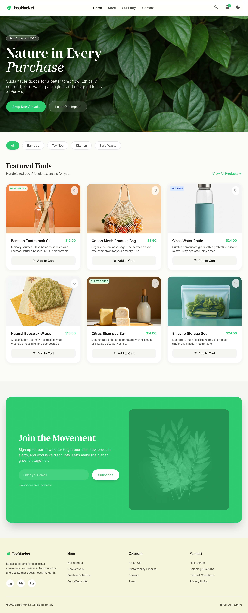
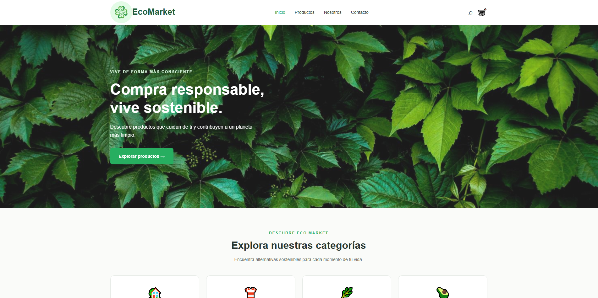
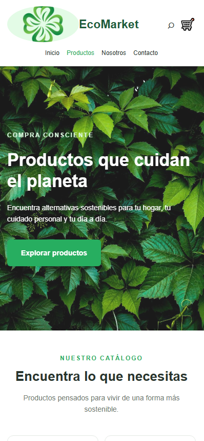

# 🌱 EcoMarket

**EcoMarket** es un sitio web de una tienda ecológica que promueve el consumo responsable y la compra de productos amigables con el medio ambiente.

El proyecto fue desarrollado utilizando HTML5 y CSS3, con un diseño adaptable a computadores y dispositivos móviles.

## 🌐 Sitio web publicado

Visita EcoMarket: [Abrir página web](https://ecomarket-chi.vercel.app/)

## 📸 Vista previa del proyecto

### 🎨 Mockup

Diseño de referencia utilizado para la apariencia visual del sitio web.





### 💻 Vista en computador

Captura del sitio web funcionando en un computador.



### 📱 Vista en celular

Captura del sitio web adaptado a un dispositivo móvil.



## 📄 Páginas del sitio web

- **Inicio:** presentación de EcoMarket, categorías y productos destacados.
- **Productos:** sección dedicada a mostrar los productos disponibles.
- **Sobre nosotros:** información sobre la tienda y su propósito ecológico.
- **Contacto:** página con información y opciones de contacto.

## 🛠️ Tecnologías utilizadas

- HTML5 para la estructura de las páginas.
- CSS3 para los estilos, la distribución de los elementos y el diseño adaptable.
- Git y GitHub para el control de versiones y el almacenamiento del proyecto.

## 📁 Estructura del proyecto

```text
EcoMarket/
├── css/
│   ├── main.css
│   ├── layout.css
│   ├── components.css
│   └── animations.css
├── img/
│   ├── products/
│   ├── icons/
│   └── hero/
├── views/
│   ├── productos.html
│   ├── sobre-nosotros.html
│   └── contacto.html
├── capturas/
├── mockup/
├── index.html
└── README.md
```

## 🚀 Cómo ejecutar el proyecto

1. Descarga o clona este repositorio.
2. Abre la carpeta del proyecto en Visual Studio Code.
3. Abre el archivo `index.html` en tu navegador.
4. Utiliza el menú de navegación para visitar las demás páginas.

## 📱 Características

- Diseño adaptable a computadores y celulares.
- Navegación entre las diferentes páginas.
- Presentación visual de productos ecológicos.
- Estilos organizados en diferentes archivos CSS.
- Imágenes y elementos gráficos integrados en el diseño.

## 🎯 Objetivo

Desarrollar un sitio web sencillo, organizado y visualmente atractivo para una tienda ecológica, aplicando los conocimientos de HTML5, CSS3 y diseño adaptable.

---

**Proyecto académico: EcoMarket** 🌿